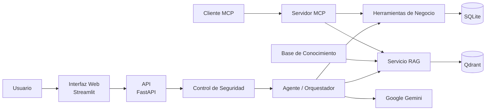

# Arquitectura Lógica

## Agente de IA de Ventas e Inventario para Piedmont Metals

## Objetivo

La arquitectura permite consultar información de productos, inventario, precios, cotizaciones y procedimientos mediante una interfaz conversacional.

El sistema mantiene separadas sus fuentes de información:

- **SQLite:** productos, precios e inventario.
- **RAG + Qdrant:** políticas y procedimientos.
- **Gemini:** interpretación y generación de respuestas complejas.
- **MCP:** acceso externo a las mismas herramientas del sistema.

---

## Diagrama de Arquitectura



---

## Flujo principal

```text
Usuario
   |
   v
Streamlit
   |
   v
FastAPI
   |
   v
Control de Seguridad
   |
   v
Agente / Orquestador
   |
   +------> Herramientas ------> SQLite
   |
   +------> RAG --------------> Qdrant
   |
   +------> Gemini
```

Las consultas simples, como inventario o precio, pueden resolverse directamente mediante herramientas.

Las consultas más complejas pueden combinar información operacional, conocimiento documental y Gemini.

---

## Herramientas de negocio

El sistema dispone de herramientas para:

- consultar inventario;
- consultar precios;
- buscar productos;
- calcular cotizaciones;
- identificar bajo inventario.

Estas herramientas consultan SQLite como fuente de datos operativos.

---

## RAG

El conocimiento documental sigue este flujo:

```text
Base de Conocimiento
        |
        v
    Embeddings
        |
        v
      Qdrant
        |
        v
Recuperación Semántica
```

RAG se utiliza para recuperar políticas y procedimientos relevantes.

---

## Model Context Protocol

MCP funciona como una interfaz adicional para clientes externos.

```text
Cliente MCP
    |
    v
Servidor MCP
    |
    +------> Herramientas ------> SQLite
    |
    +------> RAG --------------> Qdrant
```

El agente principal no necesita pasar por MCP para utilizar sus herramientas. Ambos reutilizan la misma lógica de negocio.

---

## Seguridad

Antes de procesar una consulta, el sistema aplica controles básicos de:

- validación de entrada;
- detección de información sensible;
- control de alcance;
- protección de herramientas.

---

## Alcance

Esta arquitectura corresponde a un prototipo académico.

Integraciones empresariales, autenticación avanzada y despliegue de producción quedan fuera del alcance actual.
