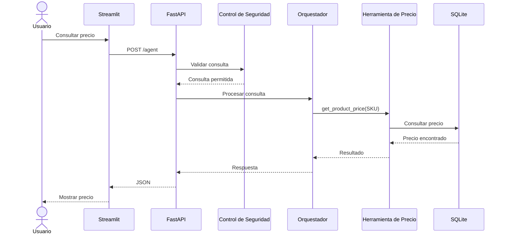
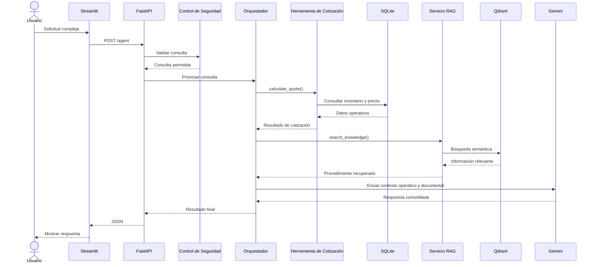
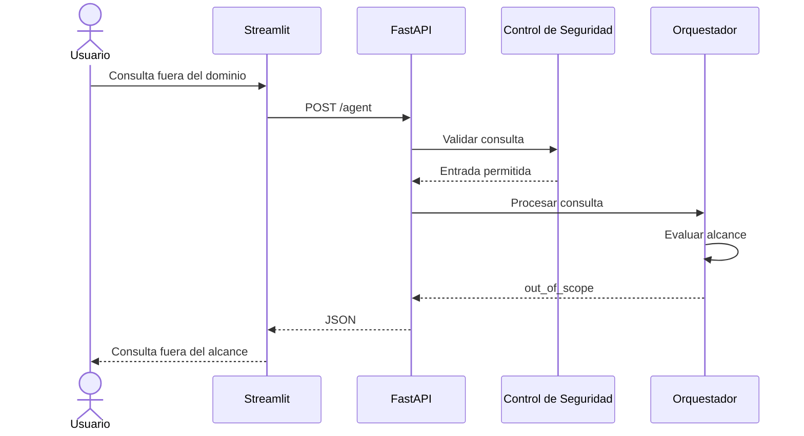
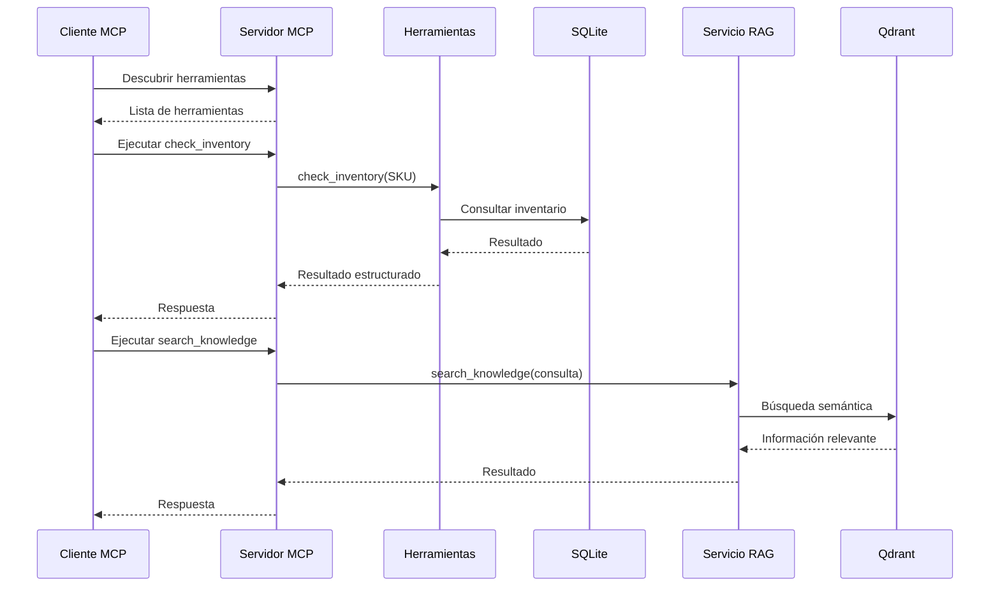

# Diagramas de Secuencia

## Agente de IA de Ventas e Inventario para Piedmont Metals

Este documento muestra los principales flujos de ejecución del prototipo.

---

## 1. Consulta simple de precio

### Caso

```text
¿Cuánto cuesta el SKU IJOIST-16-20?
```



Este tipo de consulta puede resolverse sin utilizar Gemini.

---

## 2. Consulta compleja

### Caso

```text
Necesito 20 unidades del SKU IJOIST-16-20.
¿Tenemos suficiente inventario y qué procedimiento debemos seguir si no alcanza?
```



Este flujo combina información operacional y conocimiento documental.

---

## 3. Consulta fuera del alcance

### Caso

```text
Dame código Python para sumar dos números.
```



La consulta puede rechazarse sin utilizar Gemini.

---

## 4. Flujo MCP



El servidor MCP reutiliza las mismas herramientas y servicios del sistema principal.

---

## Resumen

El prototipo implementa cuatro tipos principales de flujo:

- consulta operacional simple;
- consulta compleja;
- control de alcance;
- acceso mediante MCP.

Los datos operativos provienen de SQLite y el conocimiento documental se recupera mediante RAG y Qdrant.
